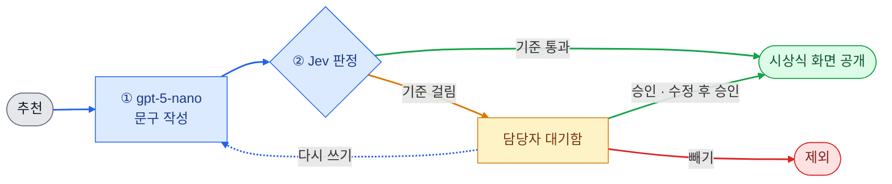

# 송년회 시상 승인 에이전트

**[데모 앱 바로가기](https://award-hitl.streamlit.app/)** · [설계와 결과 (REPORT.md)](REPORT.md) · [실행과 배포 (GUIDE.md)](GUIDE.md)

송년회 참석자 누구나 동료를 상에 추천하면, AI가 상 이름과 시상 문구를 쓰고 내보내도 되는지 판정합니다.
안전한 상은 바로 시상식 화면에 올라가고, 놀림이나 사생활이 섞인 상만 송년회 담당자에게 확인을 받습니다.

- 생성: OpenAI `gpt-5-nano` (2026-11-09 가격표 기준 가장 싼 텍스트 모델)
- 판정: TypeSafe **Jev** (창피·불쾌 확률, 사생활 노출 확률, 성격 판정)
- 멈추고 이어가기: LangGraph `interrupt` / `Command(resume=...)`, 체크포인터 `SqliteSaver`
- 데모: Streamlit

