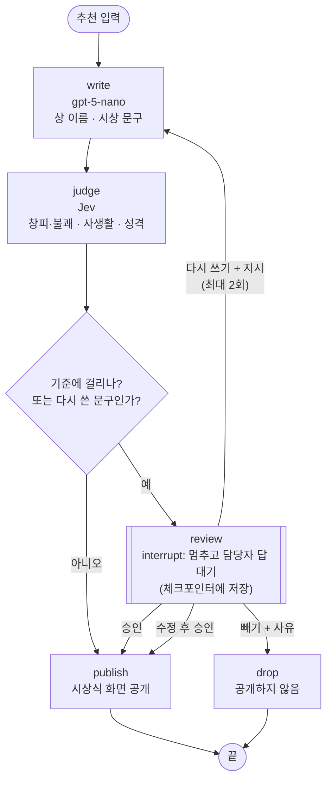
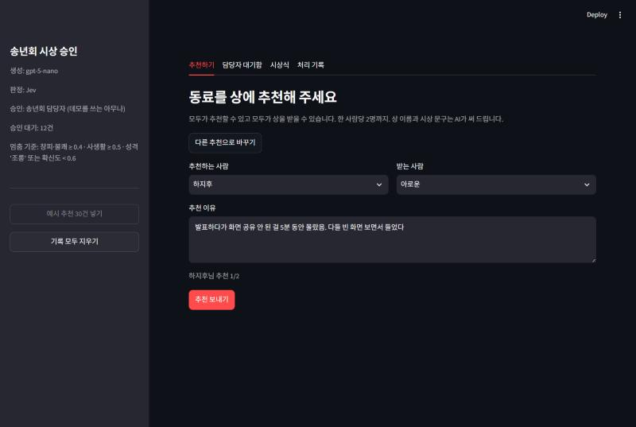
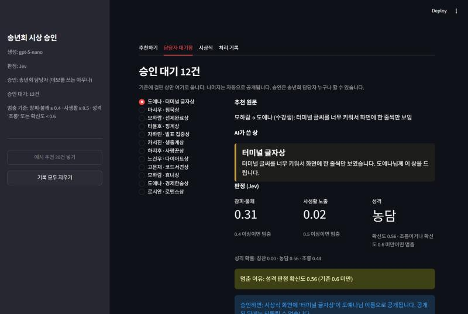
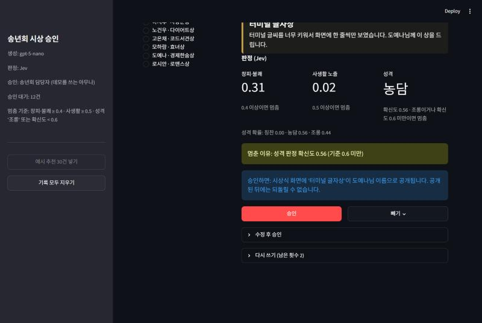
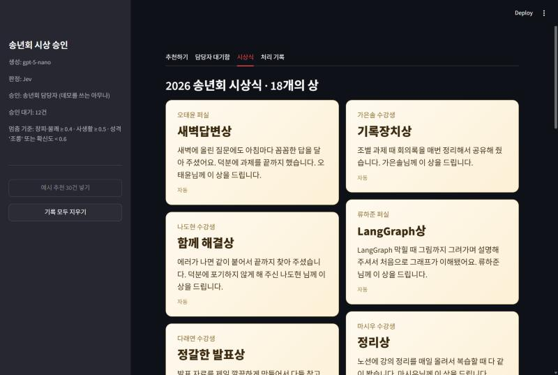
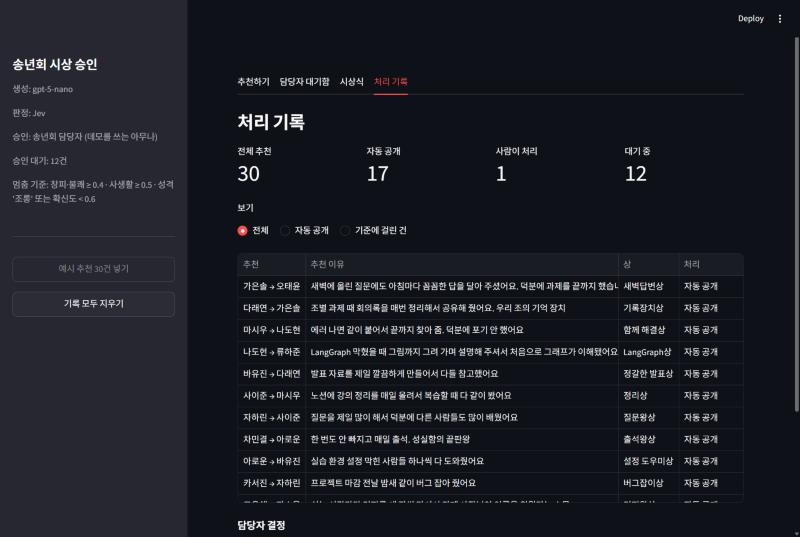

# 송년회 시상 승인 에이전트 보고서

## 1. 주제와 고른 이유

**자동화한 일**: 송년회 시상식 준비. 참석자 21명 누구나 동료를 상에 추천하면, AI가 상 이름과 시상 문구를 쓰고 시상식 화면에 올립니다.

**결과가 바깥으로 나가는 단계**: 시상식 화면 공개. 동료들 앞에 띄운 문구는 주워 담을 수 없습니다.
"졸다가 세 번 걸림" 같은 추천은 쓴 사람에게는 농담이어도 받는 사람에게는 창피한 일이 될 수 있습니다.
연애나 돈 이야기는 본인이 원하지 않는 공개가 됩니다.

**HITL이 맞는 이유**: 추천은 여러 사람이 넣고 상은 수십 개가 나옵니다. 담당자가 전부 읽기에는 많고, 대부분은 칭찬이라 볼 필요도 없습니다.
쓰는 사람(추천자)과 확인하는 사람(담당자)이 다르기 때문에, 위험한 상만 골라 사람에게 보내는 구조가 의미가 있습니다.

## 2. 파이프라인 구조

추천 한 건이 thread_id 하나입니다.

**State**

| 키 | 내용 | 쓰는 노드 |
|---|---|---|
| `rec` | 추천 id, 추천한 사람, 받는 사람, 역할, 추천 이유 | 입력 |
| `award` | 상 이름, 시상 문구, 생성 모델 | write (수정 후 승인이면 publish) |
| `judge` | 창피·불쾌 확률, 사생활 확률, 성격과 확신도, 판정 엔진 | judge |
| `stop_reasons` | 걸린 기준 문장 목록. 비면 자동 공개 | judge |
| `decision` | 담당자 답 (action, 수정본, 사유, 지시, 승인자) | review |
| `rewrites` | 다시 쓰기 횟수 | write |
| `status` | published / dropped | publish, drop |

**설계에서 지킨 것**

- 바깥으로 나가는 일은 `publish` 노드 하나에만 둡니다. `review`는 `interrupt`만 하고 부수 효과가 없습니다. 재개하면 멈췄던 노드가 첫 줄부터 다시 실행되기 때문입니다.
- `publish`는 추천 id로 덮어쓰기 저장이라, 혹시 다시 실행돼도 상이 두 번 올라가지 않습니다.
- 체크포인터는 `SqliteSaver`(파일)입니다. 담당자가 다음 날 확인해도 대기 건이 남아 있습니다.
- 담당자가 다시 쓰게 한 문구는 기준을 통과해도 담당자에게 돌아옵니다. 사람이 시작한 수정은 사람이 마무리합니다.

## 3. 승인 기준과 이유

기준은 모두 Jev가 시상 문구에 매긴 확률로 계산합니다. Jev에는 상 이름과 문구뿐 아니라 추천 사연도 함께 보여 줍니다.
송년회 청중은 사연을 아는 동료들이라, 문구가 사연을 돌려 말해도 알아듣기 때문입니다.

| 기준 | 값 | 대비하는 위험 |
|---|---|---|
| Noul "받는 사람이 창피를 당하거나 기분이 상한다" | 0.4 이상 | 실수나 창피한 순간이 공개되는 것 |
| Noul "공개하고 싶지 않을 사생활이 드러난다" | 0.5 이상 | 연애, 다이어트, 돈, 가족 이야기가 공개되는 것 |
| Choice 성격(칭찬 / 농담 / 조롱) | 조롱이거나 확신도 0.6 미만 | 의도가 애매하게 읽히는 문구. 위 두 기준이 놓친 건을 잡는 안전망 |

**자동으로 공개되는 상과 사람이 안 봐도 되는 이유**

- "새벽답변상: 새벽에 올린 질문에도 아침마다 꼼꼼한 답을 달아 주셨습니다." (창피·불쾌 0.04, 사생활 0.02, 칭찬 0.99)
- "변수명 고심상: 변수 이름을 짓는 데 코드 짜는 시간보다 더 오래 고민하셨습니다." (0.15, 0.02, 농담 0.89)

칭찬이나 수업 안의 귀여운 버릇은 공개돼도 받는 사람이 곤란해지지 않습니다. 예시 30건에서 칭찬형 12건은 창피·불쾌 점수가 모두 0.07 이하였습니다.

## 4. 기준 검증

예시 추천 30건(칭찬 12, 농담 8, 놀림 5, 사생활 5)에 "사람이 봐야 하나" 정답을 달고, 기준값 조합마다 세 값을 셌습니다. 전체 표는 [`results/criteria.md`](results/criteria.md)(보고서용 이름 세트)에 있습니다.

| 기준 | 개입률 | 놓침 | 헛멈춤 |
|---|---|---|---|
| 기준 없음 (전부 자동) | 0/30 | 10건 | 0건 |
| 창피 0.5 + 사생활 0.5, 성격 기준 끔 | 9/30 | 1건 | 0건 |
| 창피 0.4 + 사생활 0.5, 성격 기준 끔 | 11/30 | 0건 | 1건 |
| **창피 0.4 + 사생활 0.5 + 성격 기준 (채택)** | **12/30** | **0건** | **2건** |
| 창피 0.3 + 사생활 0.2 + 성격 기준 | 15/30 | 0건 | 5건 |
| 전부 멈춤 | 30/30 | 0건 | 20건 |

- **놓침이 더 비쌉니다.** 놓치면 동료 앞에서 창피한 문구가 공개되고 되돌릴 수 없습니다. 헛멈춤은 담당자가 10초 읽고 승인하면 끝납니다. 그래서 놓침 0을 지키는 기준 중에서 개입이 적은 쪽을 골랐습니다.
- 창피 기준만 0.5로 올리면 놀림 1건(코드 리뷰 때 본인 코드인 줄 모르고 누가 짰냐고 한 일, 창피 0.43)이 빠져나갑니다. 성격 기준을 켜면 이 건이 "조롱"으로 잡혀서 놓침이 0으로 돌아옵니다. 성격 기준을 안전망으로 남긴 이유입니다.
- 놀림 건 중 가장 낮은 창피 점수가 0.43이라 0.4는 여유가 크지 않습니다. 30건으로 정한 값이라 실제 송년회 추천이 쌓이면 다시 재야 합니다.
- 사생활 점수는 사생활 건이 0.87 이상, 나머지가 0.24 이하로 확실히 갈렸습니다.

**만들면서 바뀐 것**

| 문제 | 원인 | 고친 것 |
|---|---|---|
| 놀림 추천인데 "모범수강상"처럼 칭찬으로 바뀌어 놓침 4건 | gpt-5-nano가 놀리는 내용을 빼고 "~님께 이 상을 드립니다"만 씀 | 프롬프트에 "순화하지 말 것"과 예시 추가, 문구에 추천 내용이 빠지면 코드로 잡아 한 번 더 시킴. Jev에 추천 사연도 함께 보여 줌 |
| 칭찬 문구도 창피 0.8로 나와 헛멈춤 13건 | "민망하다"에 칭찬받을 때의 쑥스러움까지 들어감 | 판정 문장을 "창피를 당하거나 기분이 상한다"로 좁히고, Noul `criteria`에 참·거짓 예를 넣음. 헛멈춤 13건 → 5건 |
| 문구 끝에 받는 사람 대신 추천한 사람 이름 | 프롬프트에 두 이름이 다 있어 모델이 헷갈림 | 추천한 사람 이름을 프롬프트에서 빼고, 받는 사람 이름이 없으면 코드로 잡아 다시 시킴 |

## 5. 실행 결과

**예시 30건 (보고서용 이름 세트, 데모 화면)**: 30건 중 17건이 자동으로 공개되고 13건이 담당자 대기함으로 갔습니다. 문구는 실행마다 새로 쓰기 때문에 `evaluate.py` 결과(12건)와 한 건 차이가 납니다.
캡처 시점까지 담당자는 1건(농담형 "돌려보기상", 성격 판정 조롱 0.53)을 읽고 승인했습니다. 볼 필요가 없었던 헛멈춤 건입니다.

**참석자 명단 30건 (같은 사연, 이름만 다름)**: 문구 생성 코드를 고치기 전과 후에 한 번씩 생성해 재 보니 12/30과 14/30이 멈췄고, 두 번 모두 놓침 0건이었습니다. 결과는 [`results/attendees/criteria.md`](results/attendees/criteria.md)에 있습니다.

**네 가지 응답과 재시작**: 임시 DB에서 놀림·사생활 추천 4건을 멈춰 세운 뒤 프로그램을 끄고 새로 켰습니다. 4건 모두 대기 상태로 남아 있었고, 이어서 넣은 답대로 처리됐습니다.

| 응답 | 결과 |
|---|---|
| 승인 | 원래 문구로 공개 |
| 수정 후 승인 | 담당자가 고친 상 이름·문구로 공개 |
| 빼기 (사유: 본인이 싫어할 것 같음) | 공개 안 함, 사유 기록 |
| 다시 쓰기 (지시: 사생활 얘기는 빼고 성실함 칭찬으로) | 새 문구를 써서 다시 대기함으로 → 승인 후 공개 |

호출 비용: gpt-5-nano는 추천 한 건에 한두 번, Jev는 한 번 부릅니다. Jev 판정은 건당 0.2초 안팎이었습니다.

## 6. 데모 화면 설계

**승인 화면에 넣은 것** (강의의 "10초 안에 판단" 기준)

1. 추천 원문: 누가 누구를 왜 추천했는지
2. AI가 쓴 상 이름과 문구: 실제로 공개될 모양 그대로
3. Jev 점수 세 개와 각 기준값
4. 멈춘 이유: 어떤 기준에 몇 점으로 걸렸는지 문장으로
5. 승인하면 일어나는 일: "시상식 화면에 '○○상'이 ○○님 이름으로 공개됩니다. 공개된 뒤에는 되돌릴 수 없습니다."
6. 응답 네 개: 승인은 바로, 빼기는 사유를 써야 눌림, 수정은 문구를 고친 뒤, 다시 쓰기는 지시를 쓰고 남은 횟수를 보여 줌

**뺀 것**

- 성격 확률 전체를 막대그래프로 보여 주는 것: 숫자 한 줄로 충분하고 화면만 길어짐
- 추천한 사람의 다른 추천 목록: 판단에 필요 없고, 누가 썼는지에 시선이 쏠림
- 자동 공개된 상을 대기함에 같이 보여 주는 것: 대기함은 사람이 볼 것만. 전체는 처리 기록 탭에 따로 둠

**첫 화면**: 담당자 대기함으로 엽니다. 데모를 여는 사람이 가장 먼저 할 일이 쌓인 승인 건 처리이기 때문입니다. 메뉴 순서는 추천하기가 왼쪽입니다.

**추천 화면**: 추천하는 사람, 받는 사람, 추천 이유를 무작위로 채워 둡니다. 시연 때 청중이 버튼 한 번으로 추천을 넣을 수 있게 하려고 넣었습니다.

| 화면 | 캡처 |
|---|---|
| 추천하기 |  |
| 담당자 대기함 (판정과 멈춘 이유) |  |
| 담당자 대기함 (승인하면 일어나는 일, 응답) |  |
| 시상식 |  |
| 처리 기록 |  |

캡처는 보고서용 이름 세트(`-- --example`)로 찍었습니다. 참석자 명단과 예시의 이름은 모두 지어낸 이름입니다.

## 7. 프로젝트 회고

**가장 공들인 부분**

(작성 예정)

**앞으로 보완하고 싶은 점**

(작성 예정)
